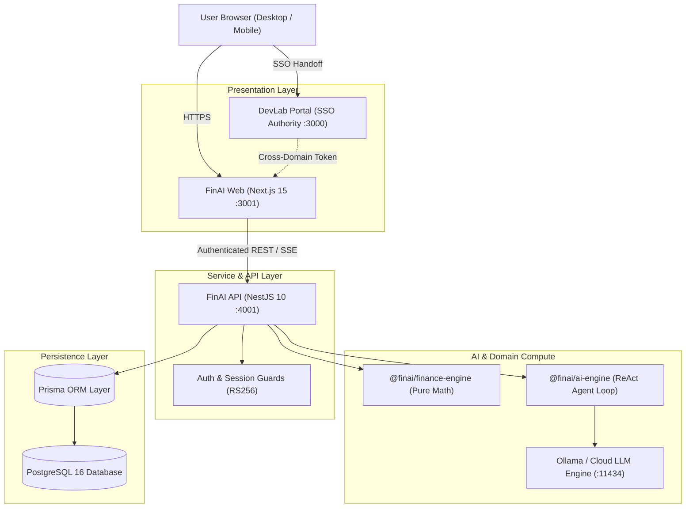

# FinAI — Enterprise AI Financial Intelligence Monorepo

[](LICENSE)
[](https://www.typescriptlang.org/)
[](https://nodejs.org/)
[](https://pnpm.io/)
[](https://nextjs.org/)
[](https://nestjs.com/)

FinAI is an enterprise-grade, full-stack, AI-powered personal and family wealth intelligence platform. It provides real-time net worth tracking, automated cash flow calculations, budget adherence scoring, investment portfolio analytics, multi-year goal projections, and an agentic financial advisor powered by local and cloud LLMs.

---

## 🏛️ System Architecture



---

## 📜 Governance & Architecture Documentation

- 📄 **[MIT License](LICENSE)**: Open-source legal licensing and terms.
- 🛡️ **[Security Policy (`SECURITY.md`)](SECURITY.md)**: Vulnerability disclosure, patch response SLAs, and security controls.
- 🤝 **[Contributing Guidelines (`CONTRIBUTING.md`)](CONTRIBUTING.md)**: Monorepo setup, conventional commits, and pre-commit quality gates.
- 📬 **Maintainer & Support**: Yuva DevLab ([yuva.devlab@gmail.com](mailto:yuva.devlab@gmail.com))
- 📐 **[Architecture Decision Records (`docs/adr/`)](docs/adr/)**:
  - [ADR 0001: Pure Platform CSS Architecture with W3C Cascade Layers](docs/adr/0001-platform-css-cascade-layers.md)
  - [ADR 0002: Distributed SSO Authentication & Redirection Loop Protection](docs/adr/0002-distributed-sso-and-loop-guard.md)
  - [ADR 0003: Monorepo Decoupling & Shared Package Boundaries](docs/adr/0003-shared-monorepo-package-boundaries.md)

---

## Workspace Coding Standards & Agent Guidelines (`.agents/AGENTS.md`)

Before writing or modifying code in FinAI, review the official [**`FinAI Coding Standards & Agent Guidelines`**](.agents/AGENTS.md):

- 📐 **2-File Feature Modal Pattern**: `<Entity>Form.tsx` (pure presentation using `<FormDialogField>`) + `<Entity>Dialog.tsx` (Zod `safeParse()` validation, React Query mutations).
- 🧮 **Pure Finance Engine**: `@finai/finance-engine` MUST contain **zero side-effects and zero I/O**.
- ✅ **Centralized Validation**: ALL validation schemas MUST reside in `@finai/validation` and use `.safeParse()`.
- 🔄 **State & Cache**: Feature hooks under `src/features/<name>/api/` using `@tanstack/react-query` with automatic `invalidateQueries()`.
- 🎨 **Styling**: Semantic design system color tokens (`bg-card`, `bg-background`, `border-border`, `text-destructive`) and Lucide icons.

---

## Modular Architecture & Rulebooks (`.agents/rules/`)

This monorepo follows a strict modular architecture governed by topic-specific rulebooks:

- 🏛️ **[`00-core-invariants.md`](.agents/rules/00-core-invariants.md)**: Monorepo package boundaries, hard 250-line rule, and database seed safeguards.
- 💻 **[`01-frontend-web.md`](.agents/rules/01-frontend-web.md)**: 2-file modal pattern, React Query caching, design system semantic tokens, and `@finai/ui`.
- ⚙️ **[`02-backend-api.md`](.agents/rules/02-backend-api.md)**: 5-layer NestJS architecture, controller/service contracts, and repository patterns.
- 🤖 **[`03-ai-advisor.md`](.agents/rules/03-ai-advisor.md)**: ReAct agent loop, tool manifests, financial personas, and 2-phase write confirmations.
- 🧪 **[`04-testing-standards.md`](.agents/rules/04-testing-standards.md)**: Vitest unit testing, Playwright E2E, mock contracts, and zero test side-effects.

---

## Workspace Documentation Directory

Click any link below to navigate to the standalone documentation for that application or package:

### Applications (`apps/`)

- 📱 **[`apps/web`](apps/web/README.md)**: Next.js 15 App Router frontend application with `@finai/ui` primitives, React Query, and standalone Docker optimization.
- ⚙️ **[`apps/api`](apps/api/README.md)**: NestJS 10 REST API backend service with Prisma ORM, Passport.js JWT authentication, and native Windows Ollama LLM integration.

### Packages (`packages/`)

- 🤖 **[`packages/ai-engine`](packages/ai-engine/README.md)**: **Shared LLM Engine & Prompt Engineering** — System personas, prompt builder factories, follow-up parsers, Ollama streaming client, and ReAct agent tool planning.
- 🧮 **[`packages/finance-engine`](packages/finance-engine/README.md)**: **Core Financial Mathematics & Metrics Engine** — Detailed mathematical formulas for Health Score (0-100), Net Worth, Savings Rate, Cash Flow, Budget Variance, Asset Allocation, and Goal Projections.
- 🗄️ **[`packages/database`](packages/database/README.md)**: PostgreSQL database schema, Prisma Client engine, migration scripts, and seed data.
- 🎨 **[`packages/ui`](packages/ui/README.md)**: Shared React component library built with design system tokens, Radix UI primitives, `<FormDialog>`, and `<FormDialogField>`.
- ✅ **[`packages/validation`](packages/validation/README.md)**: Zod validation schemas and type inferences shared across forms and API DTOs.
- 🏷️ **[`packages/shared-types`](packages/shared-types/README.md)**: Shared TypeScript interfaces, enums (`AccountType`, `TransactionType`), and API payload types.

---

## Monorepo Architecture Map

```text
fin-ai/
├── apps/
│   ├── api/                   # NestJS Backend API Service
│   └── web/                   # Next.js 15 Standalone Frontend
│
├── packages/
│   ├── ai-engine/             # LLM Client, Prompt Templates & Agent Planning
│   ├── database/              # Prisma Database Engine & Schema
│   ├── finance-engine/        # Financial Metric Calculations & Algorithms
│   ├── shared-types/          # TypeScript Types & Interfaces
│   ├── ui/                    # Shared Design System + Radix React Components
│   └── validation/            # Zod Form & API Validation Schemas
│
├── .agents/
│   └── AGENTS.md              # Workspace Coding Standards & Agent Guidelines
│
├── docker/
│   ├── api/Dockerfile         # Multi-stage NestJS Dockerfile
│   ├── web/Dockerfile         # Multi-stage Next.js Dockerfile
│   └── nginx/                 # Nginx Reverse Proxy & SSL Setup
│
├── .github/workflows/         # Code Quality CI Pipeline (ci.yml)
├── docker-compose.yml         # Production Container Orchestration
├── package.json               # Root Workspace Scripts
├── pnpm-workspace.yaml        # Monorepo Workspace Configuration
└── turbo.json                 # Turbo Build Pipeline Cache Engine
```

---

## Quickstart Commands

```bash
# 1. Install all monorepo dependencies
pnpm install

# 2. Generate Prisma Client
pnpm db:generate

# 3. Start development environment (Turbo pipeline)
pnpm dev

# 4. Run linting, typechecking & unit tests across workspace
pnpm check

# 5. Build production workspace artifacts
pnpm build
```
