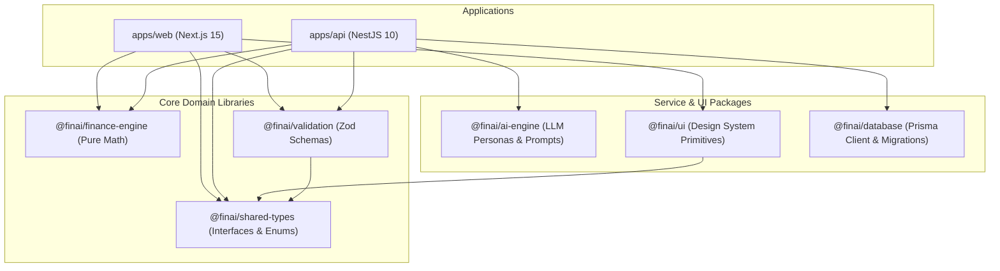

# ADR 0003: Monorepo Decoupling & Shared Package Boundaries

## Status

Accepted

## Context

In full-stack architectures, code sharing between frontend (`apps/web`) and backend (`apps/api`) often degrades into circular dependencies or leakage of server-only secrets into client bundles.

## Decision

We enforce strict package boundaries using pnpm workspaces:

1. **`@finai/shared-types`**: Pure TypeScript interfaces, enums (`TransactionType`, `AccountType`), and API payloads. Zero runtime dependencies.
2. **`@finai/validation`**: Universal Zod validation schemas with type inference. Shared across frontend forms and backend validation pipes.
3. **`@finai/finance-engine`**: Pure mathematical domain functions (Health Score, Net Worth, Savings Rate) with zero network I/O, zero side-effects, and 100% unit test coverage.
4. **`@finai/ai-engine`**: LLM prompts, persona builders, and streaming parser utilities.
5. **`@finai/ui`**: React component design system primitives with packaged styles.

## Architectural Boundary Diagram

## Consequences

### Positive

- **Bundle Safety:** Server logic (Prisma, database drivers, LLM API keys) cannot be inadvertently bundled into client code.
- **Single Source of Truth:** Form validation schemas on the client match backend validation DTOs byte-for-byte.
- **Deterministic Testing:** Domain mathematical functions in `finance-engine` are tested in microsecond unit test suites without spinning up mock databases.
